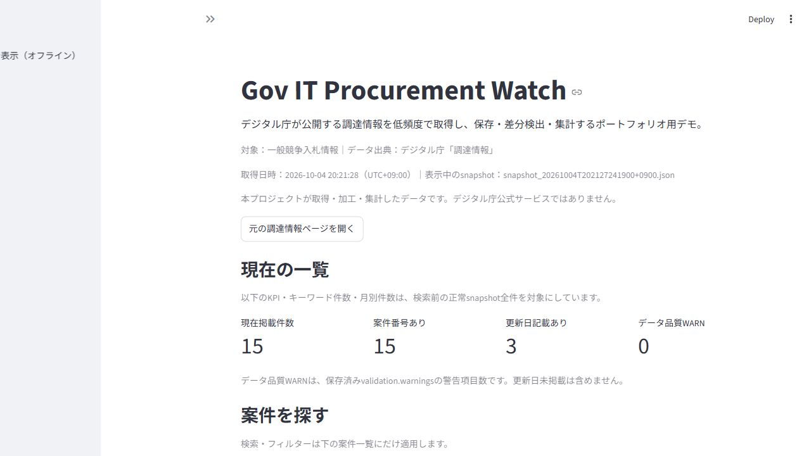
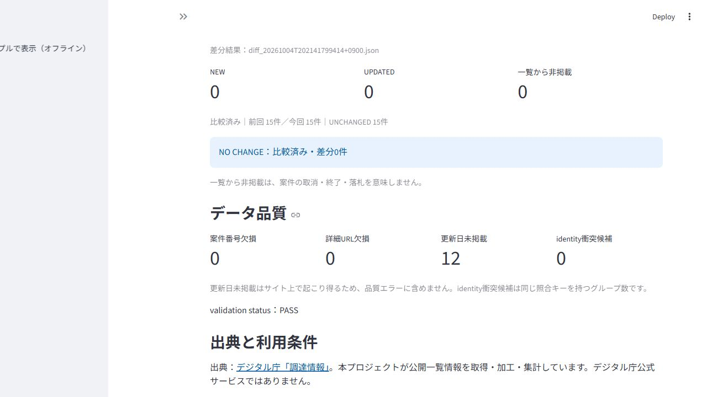
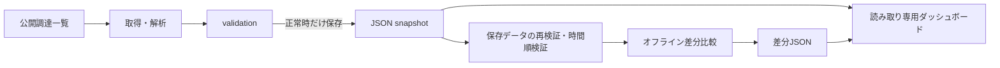

# Gov IT Procurement Watch

デジタル庁の公開調達一覧をJSONで保存し、前回との差分と現在の一覧を確認するPython／Streamlitのポートフォリオ作品です。
実データ2世代の比較と、合成データによる非ゼロ差分の表示を、オフラインで再現できます。

- **誤った差分を出さない検証**：取得失敗、データ欠損、逆順・同時刻の比較は正常結果として保存しません。
- **根拠を残す照合**：案件番号・詳細URL・案件名等を組み合わせ、曖昧な対応は保留します。
- **取得と表示の分離**：取得・比較は手動実行。ダッシュボードは保存データだけを読み、検索から再取得しません。

制作目的は、一覧の目視確認を、再現できる取得・検証・比較・表示の流れにすることです。
デジタル庁公式サービスではありません。AI分類・LLM・外部詳細本文の解析は行っていません。
ローカルGitで管理しています。Webへのホスティングは未実施です。

## 画面

2026年10月4日の保存データを表示した画面です。現在の調達状況を示すものではありません。





## システム構成



|役割|実装|
|---|---|
|初回／次回の単発取得、HTML解析、validation、キー・hash生成|`src/baseline.py`|
|正常な2世代の時間順を確認して比較、差分JSONを保存|`src/diff_engine.py`|
|最新正常snapshotの選択、集計、検索、保存差分の読込み|`src/dashboard_data.py`|
|KPI、案件一覧、検索・フィルター、集計、差分、品質表示|`app.py`|

技術スタックはPython、requests、Beautiful Soup、Streamlit、unittestです。

## セットアップとオフライン起動

Python **3.12.x**を用意し、プロジェクトルートからPowerShellで実行します。

```powershell
py -3.12 -m venv .venv
.\.venv\Scripts\python.exe -m pip install -r requirements-lock.txt
.\.venv\Scripts\python.exe -m pip check

# 同梱サンプルの15件・2世代比較を表示。データ取得は行わない
.\.venv\Scripts\python.exe -m streamlit run app.py -- --demo
```

検証環境はPython 3.12.14、Streamlit 1.65.0、requests 2.34.2、beautifulsoup4 4.15.0。
直接依存は`requirements.txt`、検証した依存バージョンは`requirements-lock.txt`に固定しています。
lockはWindows／Python 3.12で検証した組み合わせです。
接続先は`127.0.0.1`、通常ポートは8501。利用統計送信は無効です。

## 手動で取得・保存・比較する

実サイトへの取得は、現在の利用条件・robots・アクセス制限を確認したうえで手動実行します。
以下の取得コマンドはネットワーク通信を伴います。定期実行は実装していません。

```powershell
# 初回のみ：正常な取得結果をdata/baselines/へBASELINEとして保存
.\.venv\Scripts\python.exe src\baseline.py

# 次回：正常な前回データが必要。data/snapshots/へ別ファイルで保存
.\.venv\Scripts\python.exe src\baseline.py --snapshot

# 取得結果のsaved_fileに表示された実在JSONを指定する
# previousは前回、currentは今回。previousの取得日時が厳密に古い必要がある
$previous = Read-Host "前回の正常snapshot JSONのパス"
$current = Read-Host "今回の正常snapshot JSONのパス"
.\.venv\Scripts\python.exe src\diff_engine.py $previous $current --output-dir data\diffs

# data/に保存したsnapshotとdiffを表示
.\.venv\Scripts\python.exe -m streamlit run app.py
```

取得は1回のコマンドで1回だけ実行されます。初回は`BASELINE`、以後は`SNAPSHOT`として保存し、既存ファイルを上書きしません。
取得・validationに失敗した場合、正常snapshotは保存しません。
保存データがない場合は理由を表示し、サンプルを実取得データとして自動代用しません。
画面の「公開サンプルで表示（オフライン）」から明示的に切り替えられます。

仮想環境を有効化した後は、OS共通の`python`コマンドでも実行できます。
次は同梱する実在ファイルを使った**取得なし**の差分生成例です。出力は公開サンプルを変更せず`work/demo-diffs/`へ保存します。

```sh
python src/diff_engine.py data/samples/baselines/baseline_20261003T074806266523+0900.json data/samples/snapshots/snapshot_20261004T202127241900+0900.json --output-dir work/demo-diffs
python -m streamlit run app.py -- --demo
python -B -m unittest discover -s tests -v
```

初回取得は`python src/baseline.py`、次回取得は`python src/baseline.py --snapshot`です。
これらは取得なしの例と異なり、実サイトへ通信します。

## データ取得元と利用上の注意

- 出典：[デジタル庁「調達情報」](https://www.digital.go.jp/procurement)。一般競争入札情報の一覧だけが対象です。
- [デジタル庁コピーライトポリシー](https://www.digital.go.jp/copyright-policy)と[公共データ利用規約PDL1.0](https://www.digital.go.jp/resources/open_data/public_data_license_v1.0)に基づく公開一覧の利用・加工です。
- 外部調達ポータル本文、PDF、担当者情報は取得しません。詳細リンクは文字列として保存し、利用者のクリック時だけ開きます。
- このrepositoryの自作コードは[MIT License](LICENSE)です。
- デジタル庁等から取得した公開情報そのものにMIT Licenseを適用するものではありません。取得元データは提供元の利用条件（公共データ利用規約PDL1.0等）に従います。
- 出典情報は上記の出典と[公開対象方針](docs/PUBLICATION_POLICY.md)に従います。

掲載日は一覧に掲載された日付です。ページ全体の更新日を案件更新日に転用しません。
更新日未掲載は`null`で保持し、品質エラーに含めません。締切・取消・終了・落札は推測しません。

取得先は固定2URL（`robots.txt`、`procurement`）で、各1回の逐次アクセスです。
robots確認、明示的User-Agent、TLS検証、接続15秒／読取30秒timeout、リダイレクト無効、リトライ0、応答最大2MBを使用します。
403／429、アクセス制限マーカー、構造異常、validation失敗で停止します。生HTMLはメモリ内で解析し、保存しません。
公式の自動取得許諾・頻度上限は確認できていません。低頻度を想定した実装であり、サイトの許諾や網羅的なアクセス制限検出を保証しません。

## identity_keyと差分判定

保存時の`stable_key`と、世代間照合の`identity_key`を分けています。
番号があれば「機関＋案件番号」、なければ個別詳細URL、それも使えなければ「区分＋案件名＋掲載日」から照合キーを生成します。
番号の先頭ゼロを保持し、タイトル単独では照合しません。
番号だけの一致で同一案件と決めず、URLまたは案件名＋掲載日の裏付けを確認します。曖昧な対応は保留します。

|判定|意味|
|---|---|
|NEW|安全に別案件と判断できる今回のみの掲載|
|UPDATED|同一案件の意味のある項目が変化。変更前／後を記録|
|NOT_LISTED|前回にあって今回の一覧にない。取消・終了・落札を意味しない|
|UNCHANGED|content_hashが同じ|
|AMBIGUOUS_IDENTITY|照合根拠が不足・衝突しているため保留|
|DUPLICATE|同一snapshot内の実質的二重掲載。該当グループを保留|
|MISSING|必須項目不足の診断。比較を正常終了として扱わない|

content_hashは機関、区分、案件名、掲載日、更新日、案件番号、公告種別、正規化URLの8項目が対象です。
取得日時や原文日付の表記差は更新判定から除きます。
比較はtimezone付き取得日時で**前回 < 今回**を要求します。同一snapshot・同時刻・逆順は`VALIDATION_ERROR`、日時欠落・解析不能は`STRUCTURE_ERROR`で停止します。
失敗時はNEW／NOT_LISTEDを生成せず、差分結果ファイルを保存しません。

差分JSONの`previous_snapshot.path`／`current_snapshot.path`は**ファイル名のみ**を保存し、取得日時とsnapshot種別を併記します。
ダッシュボードは選択した正常snapshotの取得日時と参照を照合します。既存サンプルのデータフォルダ基準の相対参照も読み込めます。

**NO CHANGEは正常な比較結果です。** 比較済みで差分0の場合と、2世代がなく比較不能の場合を画面で区別します。

## テストと実データ検証

```powershell
# オフライン単体テスト
.\.venv\Scripts\python.exe -B -m unittest discover -s tests -v

# 保存データ／公開サンプルと合成差分の画面テスト
.\.venv\Scripts\python.exe -B tests\streamlit_app_checks.py

# 再取得保護テストだけを単独実行
.\.venv\Scripts\python.exe -B tests\test_phase1d.py
```

単体テスト73件とAppTest 7件で、取得・解析・保存保護、identity、時間順、CLI、可搬な参照、検索・フィルター・差分表示を確認します。
合成差分の画面テストは`NEW`／`UPDATED`／`NOT_LISTED`／`AMBIGUOUS_IDENTITY`を含むテスト専用データを使います。実サイトで観測した差分ではありません。
CLIは正常系、逆順、同一ファイル、入力欠落、壊れたJSON、validation失敗を確認します。

|2026年10月3日・4日の実データ2世代|結果|
|---|---|
|初回BASELINE|2026-10-03 07:48:18（UTC+09:00）、15件|
|次回snapshot|2026-10-04 20:21:28（UTC+09:00）、15件|
|validation|PASS、WARN 0|
|更新日|あり3件／未掲載12件|
|差分|NEW 0／UPDATED 0／NOT_LISTED 0／UNCHANGED 15|
|判定|SUCCESS／NO CHANGE|
|BASELINE保護|SHA-256前後一致|

**実データで非ゼロ差分はまだ観測していません。** 実データの観測結果と合成テストの結果を区別しています。
検証日時・条件・結果は[検証記録](docs/VERIFICATION.md)にまとめています。
BASELINE SHA-256：`E6B21073A160611256FA4F8B94FF7FE1E0A803E5607467A560BA89BB8A697E95`。

## リポジトリ構成

```text
app.py                  ダッシュボード
src/                    取得・差分・表示ロジック
tests/                  単体／画面テスト、公開一覧由来fixture、合成データ生成
data/samples/           2世代のオフライン表示用実データコピー
docs/                   検証記録、公開対象方針、画面画像
.streamlit/config.toml  ローカル接続・利用統計無効の設定
requirements*.txt       依存関係
```

本番保存履歴、取得・通信ログ、作業用ファイル、テスト出力、仮想環境、キャッシュ、秘密設定はGit管理対象から除外します。
出典・利用条件・取得日時を保持したサンプルを、実取得データの保存領域へ混在させません。
詳細は[公開対象方針](docs/PUBLICATION_POLICY.md)と[サンプル説明](data/samples/README.md)を参照してください。

## 既知の制限

- 一般競争入札の現在掲載分だけが対象です。全案件の網羅性・履歴・公式の月別統計を保証しません。
- HTML構造変更やアクセス制限では停止し、手動確認が必要です。
- 番号の恒久的一意性は保証せず、fallbackの案件名・日付訂正はidentityの再確認が必要です。
- キーワード集計はUnicode正規化後の部分文字列集計で、公式カテゴリやAI分類ではありません。
- サンプルは過去の15件です。現在の調達状況や実非ゼロ差分の観測実績を示しません。
- 定期実行・通知・外部本文取得・PDF解析・Webホスティングは未実施です。
- Python 3.12／Windowsで検証しています。他OSでの同等検証は未実施です。
